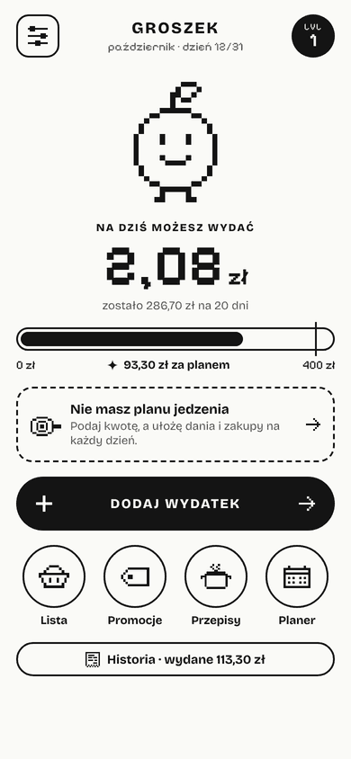
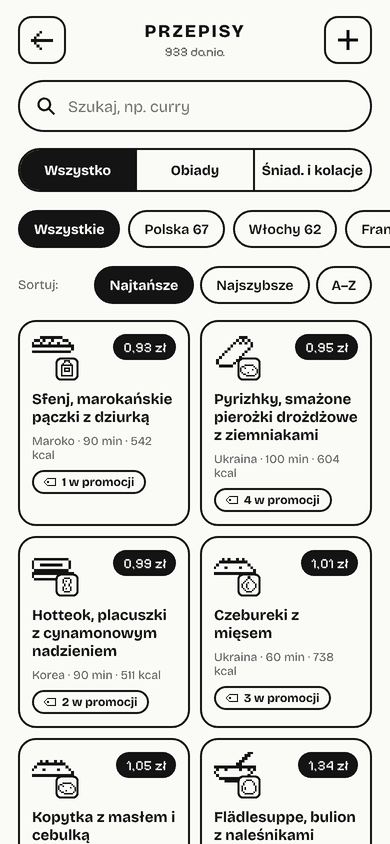
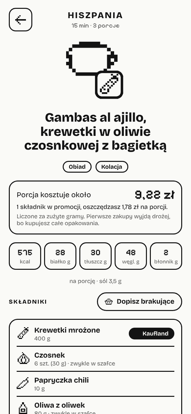
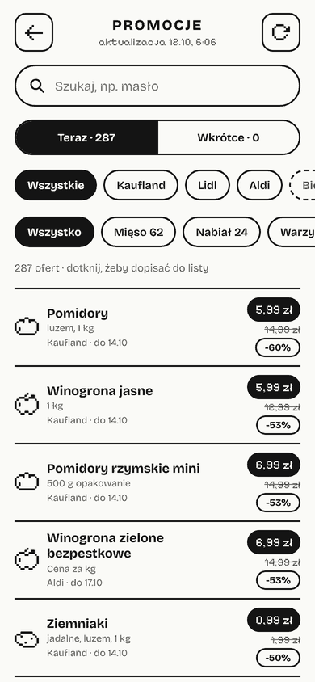
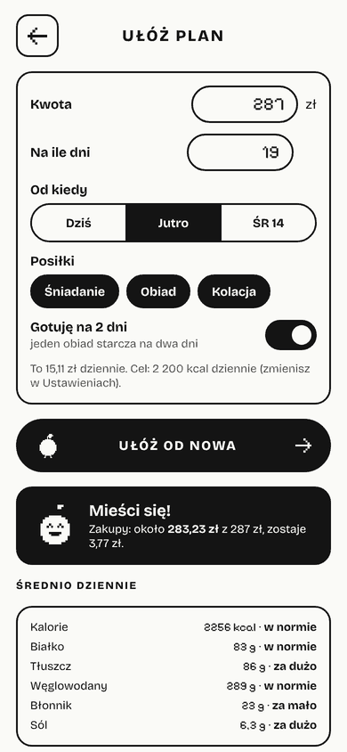

# Groszek

Groszek to apka do pilnowania budżetu na jedzenie. Mówi, ile możesz dziś wydać, znajduje promocje z Twojej listy zakupów, podsuwa tanie przepisy i układa plan posiłków na cały miesiąc za podaną kwotę.

Jest darmowa, nie ma reklam ani kont. Wszystkie dane zostają w telefonie.

  
  
  
  
  

## Instalacja

### Android

1. Pobierz plik **groszek.apk** z wydania [„najnowsza”](https://github.com/Loop-hash/groszek/releases/tag/najnowsza).
2. Otwórz go na telefonie. Za pierwszym razem Android zapyta, czy pozwolić na instalację z tego źródła.

Kolejne wersje instalują się już z samej apki: **Ustawienia → O apce → Pobierz**. Plik nie zostaje w Pobranych.

### iPhone

1. Otwórz w **Safari** stronę **https://loop-hash.github.io/groszek/**
2. Naciśnij **Udostępnij**, a potem **Do ekranu początkowego**.

Groszek pojawi się z własną ikonką i będzie otwierał się na pełnym ekranie. Działa bez internetu i aktualizuje się sam. Na iPhonie paragony czyta czytnik w przeglądarce, który radzi sobie gorzej niż ten na Androidzie.

## Co umie

**Budżet**
- Ustawiasz kwotę na jedzenie i dzień, od którego liczysz miesiąc, np. dzień stypendium.
- Na starcie widzisz, ile możesz wydać dziś, ile zostało do końca miesiąca i czy jesteś przed planem, czy za nim.
- Wydatek dodajesz klawiaturą albo zdjęciem paragonu. Groszek odczyta sumę i sklep, a wszystko dzieje się w telefonie.
- W historii są wszystkie wydatki. Za trzymanie się limitu i kupowanie w promocjach Groszek zbiera doświadczenie i wbija kolejne poziomy.

**Lista zakupów i promocje**
- Promocje z Kauflandu, Lidla i Aldi pobierają się same dwa razy w tygodniu.
- Przy rzeczach z Twojej listy Groszek pokazuje, gdzie są taniej i ile oszczędzisz.
- Tryb ostry nie pozwala dopisać do listy zachcianek, takich jak słodycze czy chipsy.

**Przepisy**
- 1099 dań z 21 kuchni: od polskiej i włoskiej po gruzińską, bośniacką, koreańską i meksykańską. Do tego podstawy, jak ugotowanie ryżu czy jajka.
- Przy każdym daniu jest cena porcji policzona z cen w sklepach i aktualnych promocji, a także kalorie, białko, tłuszcz, węglowodany, błonnik i sól.
- W ustawieniach wybierasz kuchnie i to, czego nie jesz, np. ryby albo owoce morza. Takie dania znikają z listy.
- Dania można oceniać i dodawać własne przepisy.
- Wszystkie przepisy są napisane od zera. Przycisk „Szukaj u Ani Gotuje” tylko wyszukuje podobne danie na aniagotuje.pl.

**Planer**
- Podajesz kwotę i liczbę dni, a Groszek układa śniadania, obiady i kolacje tak, żeby zmieścić się w budżecie i w dziennej liczbie kalorii.
- Plan od razu zamienia się w listę zakupów, z uwzględnieniem tego, co jest w promocji.
- Obiad można ugotować raz na dwa dni.

**Twoje dane**
- Wszystko jest zapisane tylko w telefonie.
- Kopię zrobisz w **Ustawieniach → Zapisz kopię**. Warto ją zrobić przed zmianą telefonu.

## Jak to jest zrobione

Dla ciekawych:

| Katalog | Co jest w środku |
|---|---|
| `app/` | Apka: zwykłe HTML, CSS i JavaScript, opakowane w [Capacitor](https://capacitorjs.com/) na Androida. Ten sam kod działa jako strona na iPhone'a. |
| `app/android/` | Część na Androida, w tym czytanie paragonów przez Google ML Kit i aktualizacja z apki. |
| `data/` | Przepisy, składniki i promocje w plikach JSON. Apka pobiera je z GitHuba, więc nowe przepisy i promocje nie wymagają nowej wersji apki. |
| `tools/recipes/` | Przepisy pogrupowane według kuchni. `tools/build_data.py` składa z nich `data/recipes.json` i liczy ceny oraz wartości odżywcze. |
| `tools/ingredients_src.py` | Składniki z cenami i wartościami odżywczymi z bazy USDA. |
| `scraper/` | Pobieranie promocji ze stron sklepów. |

Resztę robią automaty na GitHub Actions:
- budowanie APK i wydanie „najnowsza”,
- test apki na emulatorze Androida, łącznie z odczytem paragonów i aktualizacją,
- budowanie strony na iPhone'a,
- pobieranie promocji w poniedziałki i czwartki,
- sprawdzanie wartości odżywczych z bazą USDA.

## Źródła i licencje

- Wartości odżywcze: [USDA FoodData Central](https://fdc.nal.usda.gov/) (SR Legacy).
- Ceny składników są szacunkowe. Ceny w promocjach pochodzą ze stron sklepów.
- Czytanie paragonów: [Google ML Kit](https://developers.google.com/ml-kit/vision/text-recognition/v2) na Androidzie i [Tesseract.js](https://github.com/naptha/tesseract.js) (Apache 2.0) w przeglądarce.
- Czcionki: Pixelify Sans i Bricolage Grotesque (SIL Open Font License).
